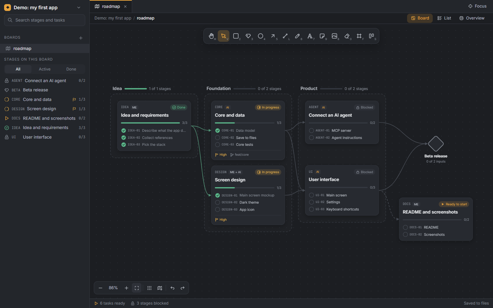
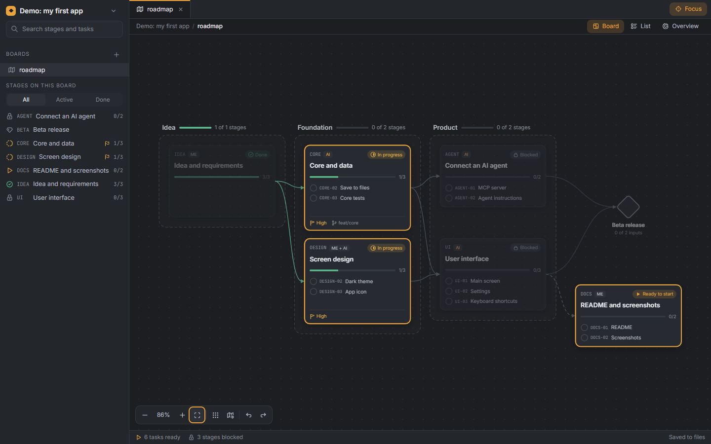
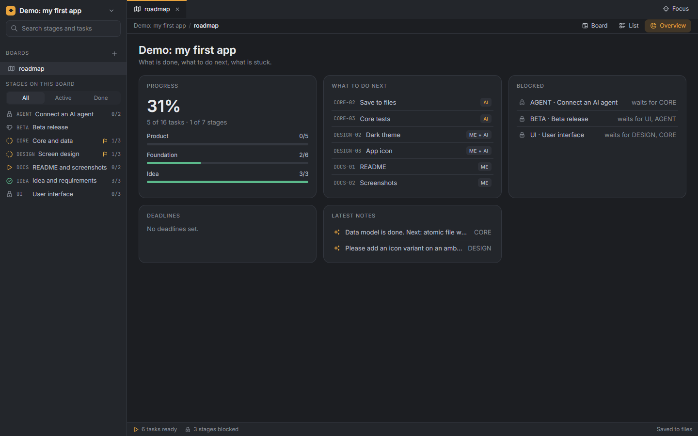
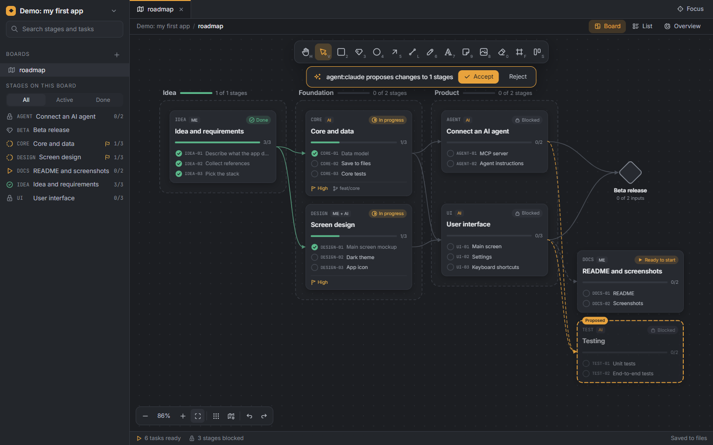
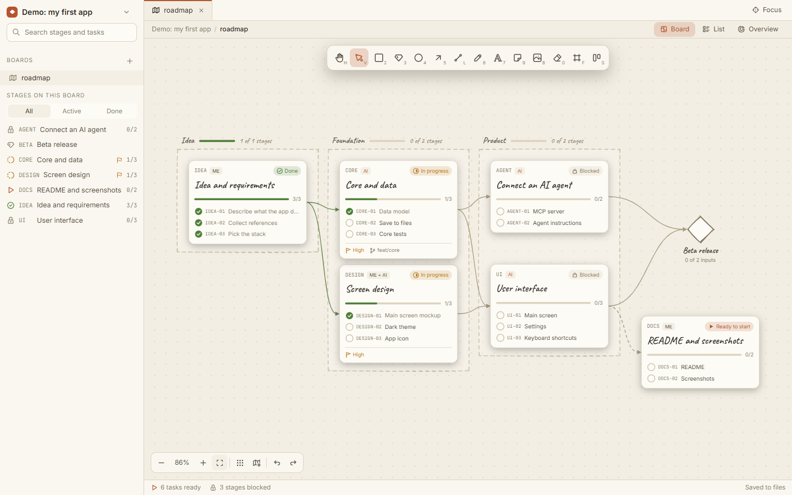
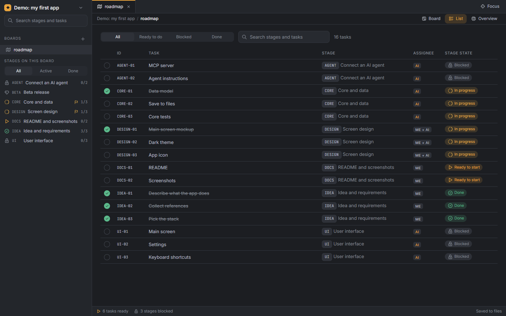
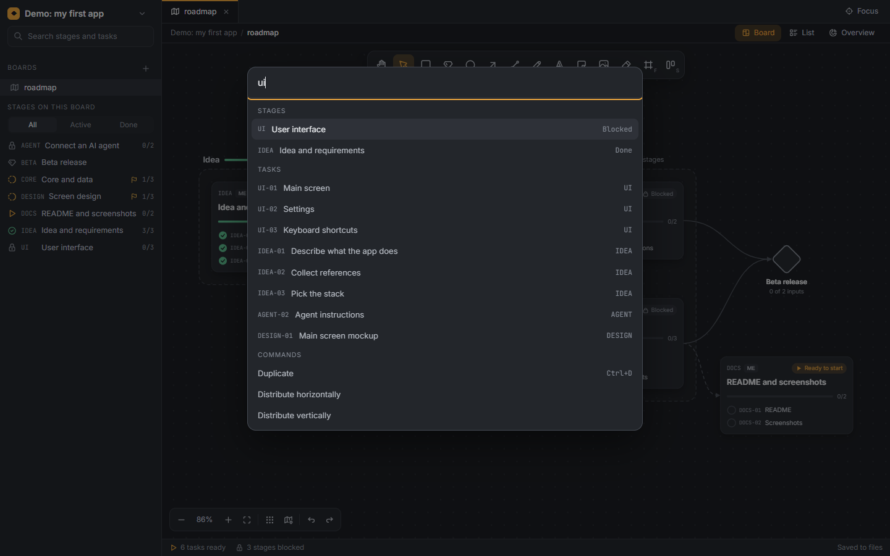

<div align="center">


# Pathloom

**A local whiteboard and roadmap for projects you build with AI agents.**

Draw freely, plan with stage cards and dependencies, and let Claude Code (or any MCP client) build and update the plan — while you watch it change live.

[Українською](README.uk.md) · [Spec](docs/spec.md) · [Ideas](docs/ideas.md)



</div>

## Why

AI agents are great at writing code but bad at keeping a shared picture of *where the project is*. Task trackers are too heavy, a TODO file is too flat. Pathloom is the middle ground:

- **A real whiteboard** — shapes, arrows, pencil, sticky notes, images, frames. Clean or hand-drawn style.
- **A real roadmap** — stage cards with task checklists, dependencies drawn as arrows, statuses computed from the graph (*ready*, *in progress*, *blocked*, *done*), phases, milestones.
- **Plain files** — the plan lives in your repo as Markdown + JSON, so it diffs, merges and reviews like code.
- **Agent-native** — a CLI and an MCP server let agents read the plan, add stages, tick tasks and leave notes. The app shows their changes instantly, highlights them, and lets you undo — or review them first.

Everything is local. No account, no cloud.

## Features

| | |
|---|---|
| **Board** | Infinite canvas, pan/zoom, rectangles, ellipses, diamonds, arrows that stick to shapes, lines, pencil, text, sticky notes, images (paste or drop), eraser, frames, groups, align & distribute, snap to grid, smart guides, minimap. |
| **Roadmap** | Stage cards with task IDs (`AUTH-03`) and subtasks, dependencies (hard or soft), cycle protection, computed statuses, phases with progress, milestones. |
| **Focus mode** | `E` hides finished work and highlights what you can do right now. |
| **Views** | Board, List (all tasks with filters), Overview (progress, what's next, blockers, deadlines, latest notes). |
| **Agents** | `pathloom` CLI and `pathloom mcp` server, live reload, change highlights, one-click undo of agent changes, review mode with proposals shown as dashed cards. |
| **Comfort** | `Ctrl+K` command palette, rebindable shortcuts that work on any keyboard layout, Graphite / Light / Warm paper themes plus your own theme files, English and Ukrainian UI. |

<table>
<tr>
<td><br><sub>Focus mode</sub></td>
<td><br><sub>Overview</sub></td>
</tr>
<tr>
<td><br><sub>An agent's proposal waiting for review</sub></td>
<td><br><sub>Warm paper theme, hand-drawn style</sub></td>
</tr>
<tr>
<td><br><sub>All tasks as a list</sub></td>
<td><br><sub>Command palette (Ctrl+K)</sub></td>
</tr>
</table>

## Install

Download the installer for your system from [Releases](https://github.com/XxArDy/Pathloom/releases) (Windows `.exe` / `.msi`, macOS `.dmg`, Linux `.AppImage` / `.deb`).

To update, run the new installer over the old one. On Windows prefer the `.exe`: AI agent sessions that are using Pathloom keep working during the update and pick up the new version when they restart.

> Builds are not code-signed yet, so Windows SmartScreen and macOS Gatekeeper will warn on first launch.

The `pathloom` command-line tool is installed next to the app. **Settings → AI agents** shows its path and ready-to-copy commands.

## Use it with Claude Code

Give Claude Code the Pathloom tools once:

```bash
claude mcp add pathloom -- pathloom mcp
```

Or install the plugin (MCP server + a planning skill that teaches the agent the workflow):

```
/plugin marketplace add XxArDy/Pathloom
/plugin install pathloom@pathloom
```

Then just ask, inside your project:

> Plan the MVP in Pathloom: stages for backend, frontend and release, with dependencies.

> What can I work on next?

> Mark the login tasks as done and leave a note about what changed.

Other MCP clients (Cursor, etc.) use the same server: `{"command": "pathloom", "args": ["mcp"]}`.

### What the agent can do

| Tool | |
|---|---|
| `project_info`, `list_stages`, `get_stage`, `search` | Read the plan without dumping whole boards. |
| `next` | Tasks that can be done right now, by priority and due date. |
| `apply` | Create or update many stages, tasks, dependencies, frames and comments in one transactional call. |
| `set_task`, `add_comment` | Track progress and leave notes for you. |
| `claim_task`, `release_task` | Take a task so other agents don't work on the same thing (expires after 30 min unless renewed). |
| `activity` | What other agents and you did recently. |
| `heartbeat` | "Still working" during long steps; after 10 silent minutes the card shows the agent as possibly stuck. |
| `set_gate`, `report_usage` | Report a gate's check result; optionally report tokens and cost. |
| `import_tasks` | Turn a GitHub Spec Kit `tasks.md` into stages, tasks and dependencies. |
| `layout_board`, `validate` | Tidy the board, check the plan for problems. |

**Done means proven.** An agent closes a task with the check it ran (`set_task` with `evidence`, or `pathloom task done AUTH-02 --run "cargo test"`): the task shows as verified, and a failing check never closes it. Turn on *Agents must prove a task is done* in Settings to require it. **Gate** stages (`kind: gate`, `check: npm test`) are done only when their check passes. Stages can list hand-off files (spec, plan) as **artifacts**, and Overview shows the **spending** agents report.

**Several agents at once.** Stages can be assigned to a named agent (`who: ai:claude`, `ai:codex`) or person (`human:olia`) — each gets its own colour. An agent claims a task before working on it; the card shows who is on it, and other agents skip it. **Overview** shows who is working right now and a feed of agent activity (`.pathloom/log/agent.jsonl`).

Prefer to approve changes first? Switch **Settings → AI agents → Ask me first**. Agent changes then arrive as proposals you accept or reject.

## The files

```
my-project/
  .pathloom/project.toml          settings (e.g. agent_changes = "review")
  plan/
    stages/AUTH.md                one stage: frontmatter + task checklist + comments
    boards/roadmap.board.json     card positions, drawings, frames (one element per line)
    assets/                       pasted images
```

```markdown
---
id: AUTH
title: Authentication
kind: stage
who: ai
priority: high
depends: [CORE]
---
## Tasks
- [x] AUTH-01 Login form
- [ ] AUTH-02 Session storage
  - [ ] AUTH-02a Refresh tokens
```

Edit them by hand, with an agent, or in the app — all three stay in sync.

## CLI

```bash
pathloom init
pathloom stage add AUTH "Authentication" --after CORE
pathloom task add AUTH "Login form"
pathloom task done AUTH-01
pathloom next
pathloom apply plan.yaml --dry-run
pathloom validate --fix
```

Every command supports `--json`. See [crates/pathloom-cli/README.md](crates/pathloom-cli/README.md).

## Build from source

Requirements: Rust (stable), Node.js 20+, and the [Tauri prerequisites](https://tauri.app/start/prerequisites/) for your OS.

```bash
npm install
npm run build:cli -w @pathloom/desktop
npm run tauri dev -w @pathloom/desktop
```

Installers: `npm run tauri build -w @pathloom/desktop`.

| Part | Path | Stack |
|---|---|---|
| Core (files, graph, statuses, apply, layout) | `crates/pathloom-core` | Rust |
| CLI + MCP server | `crates/pathloom-cli` | Rust, `rmcp` |
| Canvas editor | `packages/canvas` | TypeScript, Canvas2D |
| Desktop app | `apps/desktop` | Tauri 2, React |
| Claude Code plugin | `plugin/` | MCP + skill |

Tests: `cargo test --workspace` and `npm run test -w @pathloom/canvas`.

## Status

Early but usable (0.1). Tested on Windows. Linux and macOS builds are produced by the release workflow but have not been tried on real machines yet. See [docs/ideas.md](docs/ideas.md) for what's next.

## License

Dual-licensed under [MIT](LICENSE-MIT) or [Apache-2.0](LICENSE-APACHE), at your option.
