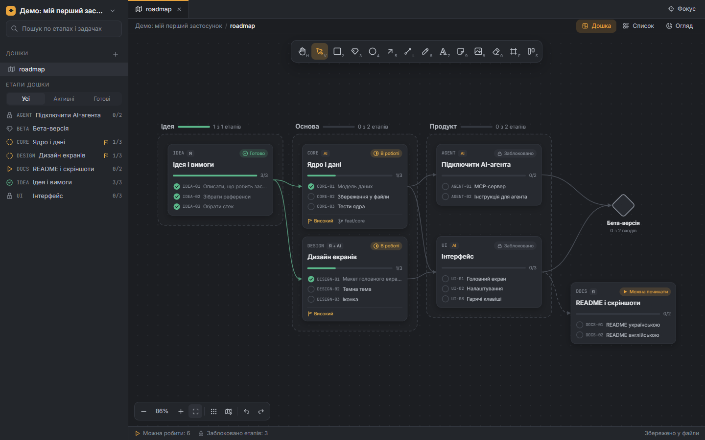
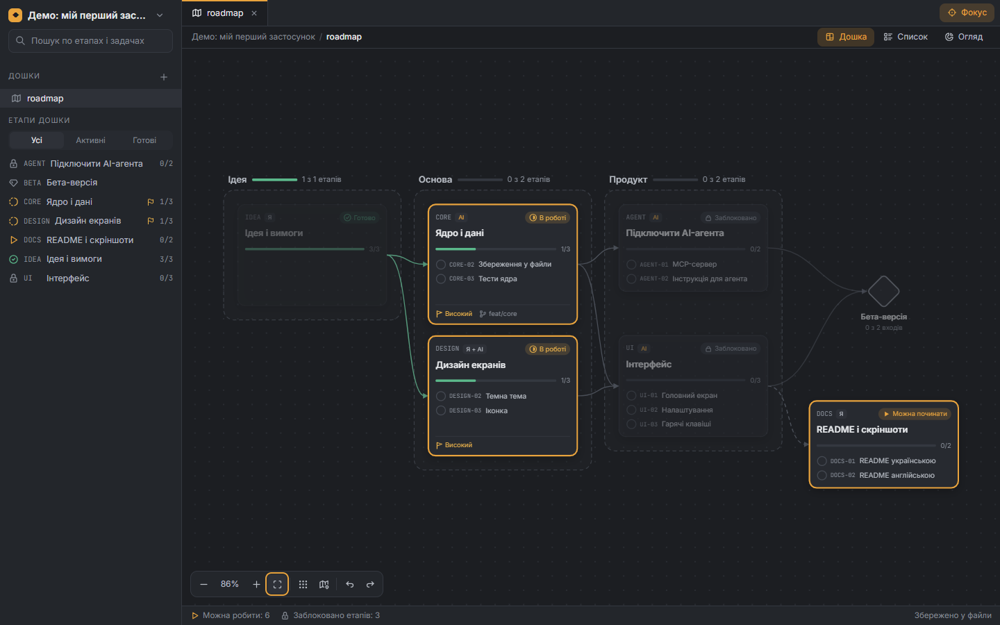
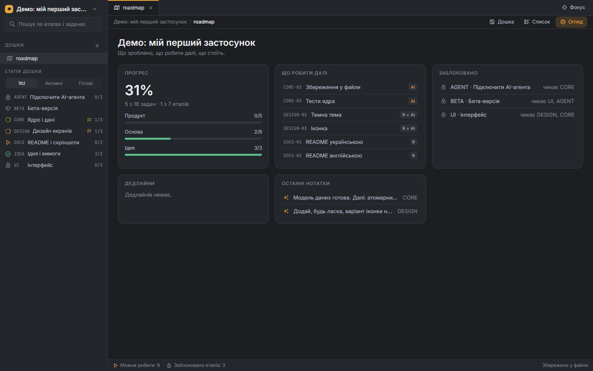
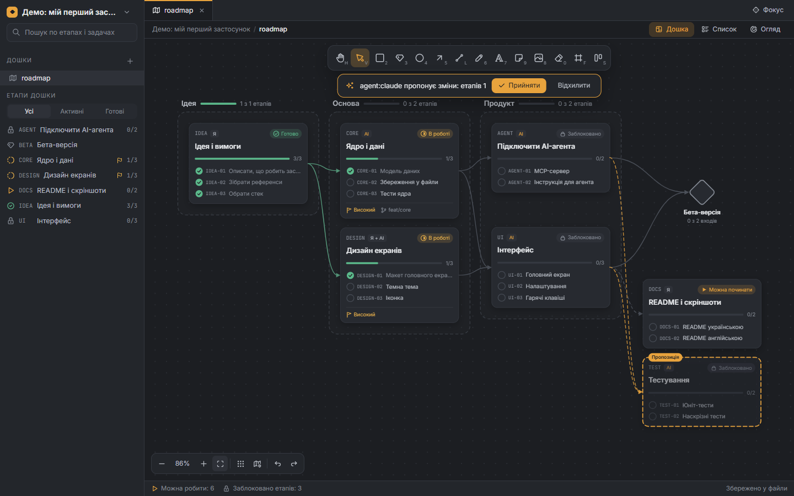
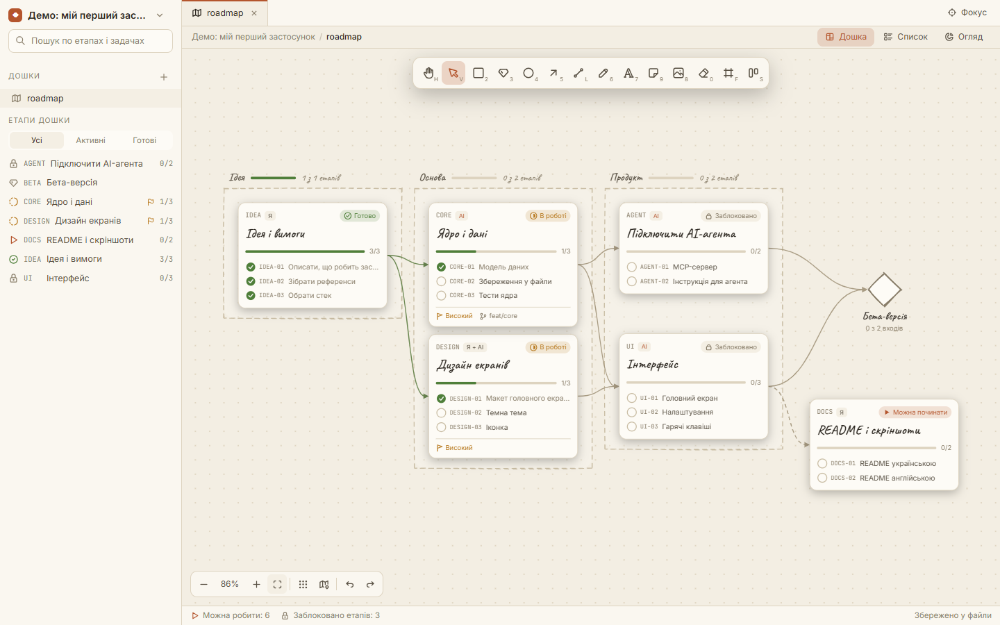
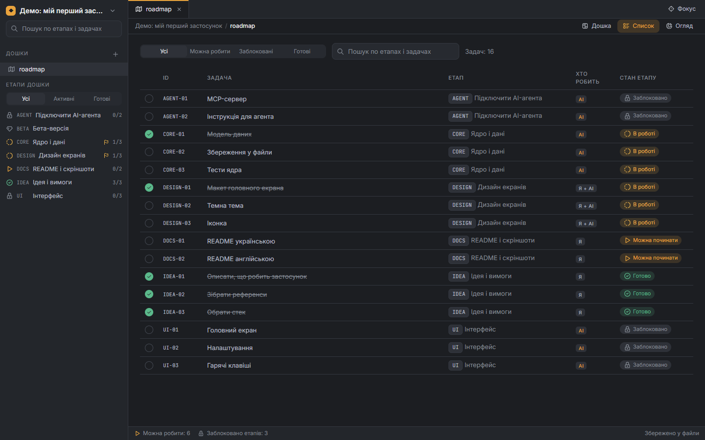
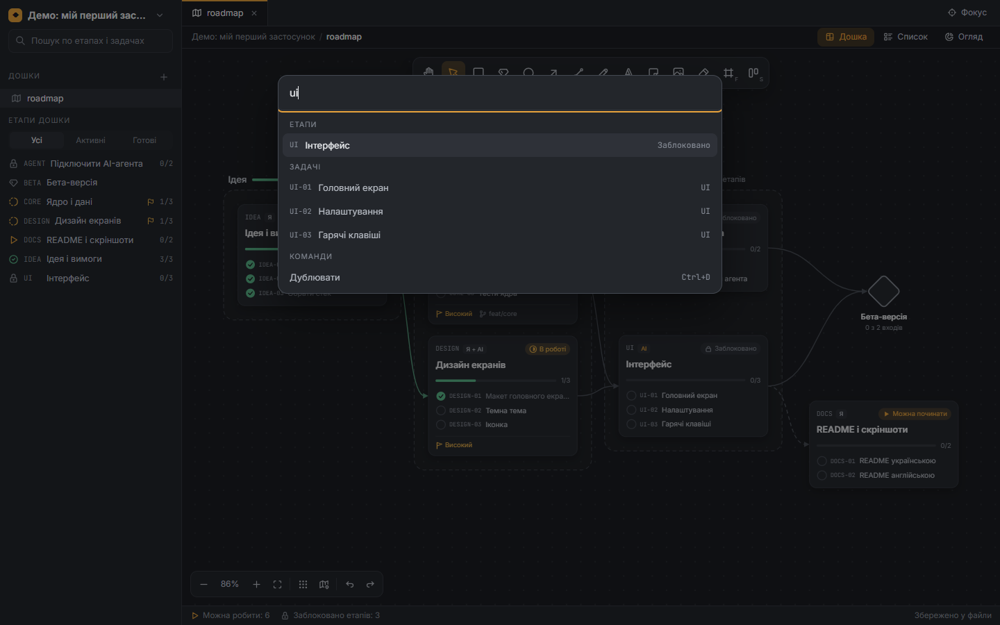

<div align="center">


# Pathloom

**Локальна дошка й roadmap для проєктів, які ти будуєш з AI-агентами.**

Малюй вільно, плануй картками етапів і залежностями, а Claude Code (чи будь-який MCP-клієнт) хай будує й оновлює план — ти бачиш зміни наживо.

[English](README.md) · [Специфікація](docs/spec.md) · [Ідеї](docs/ideas.md)



</div>

## Навіщо

AI-агенти добре пишуть код, але погано тримають спільну картину того, *де зараз проєкт*. Трекери задач заважкі, TODO-файл заплаский. Pathloom — посередині:

- **Справжня дошка** — фігури, стрілки, олівець, стікери, зображення, рамки. Рівний або «від руки» стиль.
- **Справжній roadmap** — картки етапів зі списками задач, залежності стрілками, стани рахуються з графа (*можна починати*, *в роботі*, *заблоковано*, *готово*), фази, milestone.
- **Звичайні файли** — план лежить у твоєму репо як Markdown + JSON: його видно в diff, він мержиться й рев'юїться як код.
- **Зроблено для агентів** — CLI та MCP-сервер дають агенту читати план, додавати етапи, відмічати задачі й лишати нотатки. Застосунок одразу показує зміни, підсвічує їх і дає скасувати — або спершу переглянути.

Усе локально. Без акаунта й хмари.

## Можливості

| | |
|---|---|
| **Дошка** | Нескінченне полотно, рух і масштаб, прямокутники, еліпси, ромби, стрілки, що чіпляються до фігур, лінії, олівець, текст, стікери, зображення (вставити чи перетягнути), гумка, рамки, групи, вирівнювання й розподіл, прилипання до сітки, розумні напрямні, мінімапа. |
| **Roadmap** | Картки етапів з ID задач (`AUTH-03`) і підзадачами, залежності (жорсткі й м'які), захист від циклів, обчислювані стани, фази з прогресом, milestone. |
| **Режим «Фокус»** | `E` ховає зроблене й підсвічує те, що можна робити зараз. |
| **Перегляди** | Дошка, Список (усі задачі з фільтрами), Огляд (прогрес, що далі, що стоїть, дедлайни, останні нотатки). |
| **Агенти** | CLI `pathloom` і сервер `pathloom mcp`, живе оновлення, підсвітка змін, скасування змін агента одним кліком, режим перевірки з пропозиціями пунктирними картками. |
| **Зручність** | Палітра команд `Ctrl+K`, гарячі клавіші, які можна змінити і які працюють з українською розкладкою, теми Graphite / Light / Warm paper і власні файли тем, інтерфейс українською та англійською. |

<table>
<tr>
<td><br><sub>Режим «Фокус»</sub></td>
<td><br><sub>Огляд</sub></td>
</tr>
<tr>
<td><br><sub>Пропозиція агента чекає на перевірку</sub></td>
<td><br><sub>Тема Warm paper, стиль «від руки»</sub></td>
</tr>
<tr>
<td><br><sub>Усі задачі списком</sub></td>
<td><br><sub>Палітра команд (Ctrl+K)</sub></td>
</tr>
</table>

## Встановлення

Завантаж інсталятор для своєї системи з [Releases](https://github.com/XxArDy/Pathloom/releases) (Windows `.exe` / `.msi`, macOS `.dmg`, Linux `.AppImage` / `.deb`).

> Збірки поки без цифрового підпису, тому Windows SmartScreen і macOS Gatekeeper попередять при першому запуску.

Інструмент командного рядка `pathloom` встановлюється поруч із застосунком. **Налаштування → AI-агенти** показують шлях до нього й готові команди для копіювання.

## Як працювати з Claude Code

Один раз дай Claude Code інструменти Pathloom:

```bash
claude mcp add pathloom -- pathloom mcp
```

Або встанови плагін (MCP-сервер + skill, що вчить агента робочого процесу):

```
/plugin marketplace add XxArDy/Pathloom
/plugin install pathloom@pathloom
```

Далі просто проси у своєму проєкті:

> Сплануй MVP у Pathloom: етапи для бекенду, фронтенду й релізу, із залежностями.

> Що я можу робити далі?

> Познач задачі логіну виконаними й залиш нотатку, що змінилося.

Інші MCP-клієнти (Cursor тощо) підключаються до того самого сервера: `{"command": "pathloom", "args": ["mcp"]}`.

### Що вміє агент

| Інструмент | |
|---|---|
| `project_info`, `list_stages`, `get_stage`, `search` | Читати план, не вивантажуючи цілі дошки. |
| `next` | Задачі, які можна робити зараз, за пріоритетом і дедлайном. |
| `apply` | Створити чи змінити багато етапів, задач, залежностей, рамок і коментарів одним транзакційним викликом. |
| `set_task`, `add_comment` | Відмічати прогрес і лишати тобі нотатки. |
| `claim_task`, `release_task` | Взяти задачу, щоб інші агенти не робили те саме (захоплення спливає через 30 хв, якщо не продовжити). |
| `activity` | Що нещодавно робили інші агенти й ти. |
| `layout_board`, `validate` | Впорядкувати дошку, перевірити план на проблеми. |

**Кілька агентів одночасно.** Етап можна призначити конкретному агенту (`who: ai:claude`, `ai:codex`) або людині (`human:olia`) — у кожного свій колір. Агент «бере» задачу перед роботою; на картці видно, хто нею зайнятий, а інші агенти її пропускають. В **«Огляді»** видно, хто працює зараз, і стрічку дій агентів (`.pathloom/log/agent.jsonl`).

Хочеш спершу переглядати зміни? Увімкни **Налаштування → AI-агенти → Спершу питати мене**. Тоді зміни агента приходять як пропозиції, які ти приймаєш або відхиляєш.

## Файли

```
my-project/
  .pathloom/project.toml          налаштування (напр. agent_changes = "review")
  plan/
    stages/AUTH.md                один етап: frontmatter + список задач + коментарі
    boards/roadmap.board.json     позиції карток, малюнки, рамки (один елемент на рядок)
    assets/                       вставлені зображення
```

```markdown
---
id: AUTH
title: Авторизація
kind: stage
who: ai
priority: high
depends: [CORE]
---
## Tasks
- [x] AUTH-01 Форма входу
- [ ] AUTH-02 Збереження сесії
  - [ ] AUTH-02a Оновлення токенів
```

Редагуй їх руками, агентом або в застосунку — усе тримається в синхроні.

## CLI

```bash
pathloom init
pathloom stage add AUTH "Авторизація" --after CORE
pathloom task add AUTH "Форма входу"
pathloom task done AUTH-01
pathloom next
pathloom apply plan.yaml --dry-run
pathloom validate --fix
```

Кожна команда має `--json`. Докладніше: [crates/pathloom-cli/README.md](crates/pathloom-cli/README.md).

## Зібрати з коду

Потрібні: Rust (stable), Node.js 20+ і [залежності Tauri](https://tauri.app/start/prerequisites/) для твоєї ОС.

```bash
npm install
npm run build:cli -w @pathloom/desktop
npm run tauri dev -w @pathloom/desktop
```

Інсталятори: `npm run tauri build -w @pathloom/desktop`.

| Частина | Шлях | Стек |
|---|---|---|
| Ядро (файли, граф, стани, apply, layout) | `crates/pathloom-core` | Rust |
| CLI + MCP-сервер | `crates/pathloom-cli` | Rust, `rmcp` |
| Редактор полотна | `packages/canvas` | TypeScript, Canvas2D |
| Застосунок | `apps/desktop` | Tauri 2, React |
| Плагін Claude Code | `plugin/` | MCP + skill |

Тести: `cargo test --workspace` і `npm run test -w @pathloom/canvas`.

## Стан

Рання, але робоча версія (0.1). Перевірено на Windows. Збірки для Linux і macOS робить workflow релізу, але на реальних машинах їх ще не запускали. Що далі — у [docs/ideas.md](docs/ideas.md).

## Ліцензія

На вибір: [MIT](LICENSE-MIT) або [Apache-2.0](LICENSE-APACHE).
